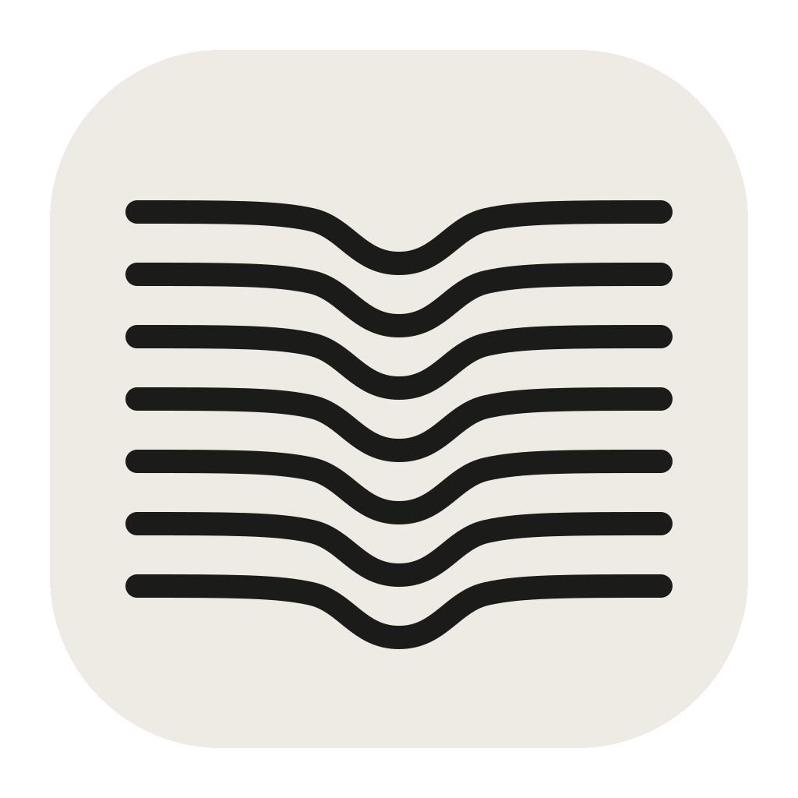

<div align="center">
  
  <h1>Speakeasy</h1>
  <p><strong>Fast, private dictation for macOS.</strong></p>
  <p>Press fn, speak, and the text is pasted where you were typing.<br>Transcription runs on your Mac.</p>
</div>

## What it does

- **Dictate anywhere.** Tap **fn** to start and stop, or hold it to talk. In hold-to-talk mode, double-tap **fn** to keep dictating hands-free until the next press. The text is pasted into the app you were using, on any keyboard layout.
- **Local.** Speech is transcribed on your Mac and nothing is sent anywhere; the only network use is downloading the model (and update checks in builds that include the updater). Dictation audio is never written to disk. Meeting recordings, which you turn on yourself, keep their audio in Application Support for as long as you choose. Markup screenshots stay in Application Support; only the 20 most recent are kept.
- **AirPods stay in high quality.** When the system input is a Bluetooth headset, Speakeasy records from the Mac's built-in microphone so your headphones don't drop into call mode. Turn this off in Settings → Microphone.
- **Undo and learn.** **Undo Last Dictation** in the menu removes the paste in the app that received it. Fix a transcript in History; fix the same words twice and Speakeasy offers to make it a correction.
- **Meetings.** Turn on Settings → Meetings, then choose **Record Meeting**, or accept the offer when Zoom, Teams, FaceTime, Slack, or a browser call starts using the microphone (macOS 14.2+). Speakeasy records your microphone and, with Screen Recording access, the other side, for as long as the call runs. It transcribes as you go and saves a transcript labeled You/Them with talk time, likely action items, and, on macOS 26 with Apple Intelligence, a short summary.
- **Fast.** On an M4 Pro, the default model transcribes a short clip in about 20 ms once loaded.
- **Recoverable.** Each transcript is saved before it is pasted. If a paste fails, copy or paste it again from the menu bar.
- **Corrections.** Add replacements like "cube control → kubectl". They apply to every dictation after you save them.
- **Show, don't describe.** While dictating, hold **Shift** and move the pointer to draw on the screen, or Shift-click to pin a point; Shift-click a mark to remove it. Clicks and scrolls still reach your apps, and scrolling fades the marks so they never sit on the wrong content. When you stop, Speakeasy pastes your transcript split per mark (`#1 (0:05) "…"`) into the front app, with the path to a contact sheet of cropped screenshots that carry the same number and time, so a coding agent can open it. Turn it on from the menu with **Enable Draw While Dictating…** (macOS 14+, needs Screen Recording access). Without a mark, dictation works as before.

## Models

Speakeasy downloads the default model on first launch and checks its SHA-256 before loading it.

| | Model | Size |
|---|---|---:|
| **Default** | [Parakeet TDT+CTC 110M](https://huggingface.co/handy-computer/parakeet-tdt_ctc-110m-gguf) | 135 MB |
| Optional | [Parakeet Unified EN 0.6B](https://huggingface.co/handy-computer/parakeet-unified-en-0.6b-gguf) | 731 MB |

Both are English-only, run on the GPU through [transcribe.cpp](https://github.com/handy-computer/transcribe.cpp), and are licensed CC-BY-4.0. Switch models in Settings.

## Install

Requires an Apple Silicon Mac running macOS 12 or later.

1. Download the latest `Speakeasy-*.zip` from [Releases](https://github.com/Yeshwanthyk/speakeasy/releases), unzip it, and move **Speakeasy** to Applications.
2. Open it. macOS blocks the first launch because the app is not notarized. Go to **System Settings → Privacy & Security** and click **Open Anyway**.
3. Allow **Microphone** access, **Accessibility** access so Speakeasy can paste, and **Input Monitoring** so it can see the fn key in every app. Setup walks through all three, then has you try a dictation and explains anything that went wrong (too short, a silent microphone, no speech heard).

> **After updating:** macOS may forget the Accessibility permission. If paste stops working, remove Speakeasy from **Privacy & Security → Accessibility** and add it again.

## Build from source

Requires Xcode command-line tools and [Rust](https://rustup.rs).

```bash
git clone https://github.com/Yeshwanthyk/speakeasy.git
cd speakeasy
./script/build_and_run.sh
```

This builds the app, installs it to `~/Applications`, and opens it. Run the tests with `swift test`. [ARCHITECTURE.md](ARCHITECTURE.md) describes the internals.

## Credits

Speech recognition uses NVIDIA's Parakeet models through [transcribe.cpp](https://github.com/handy-computer/transcribe.cpp). The recording overlay adapts code from [Megaphone](https://github.com/Kuberwastaken/megaphone). See [THIRD_PARTY_NOTICES.md](THIRD_PARTY_NOTICES.md).

## License

[MIT](LICENSE). Model weights are licensed separately (CC-BY-4.0).
